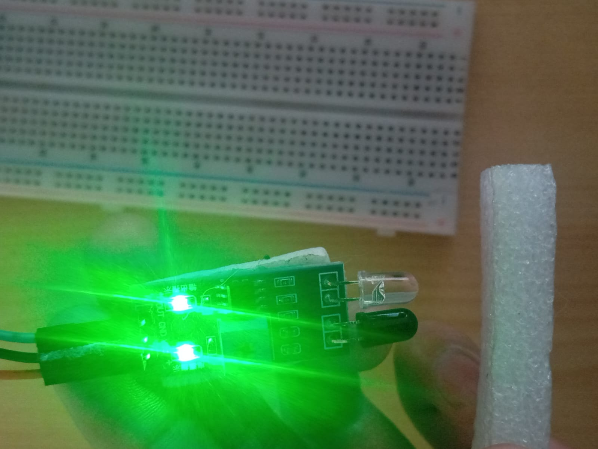
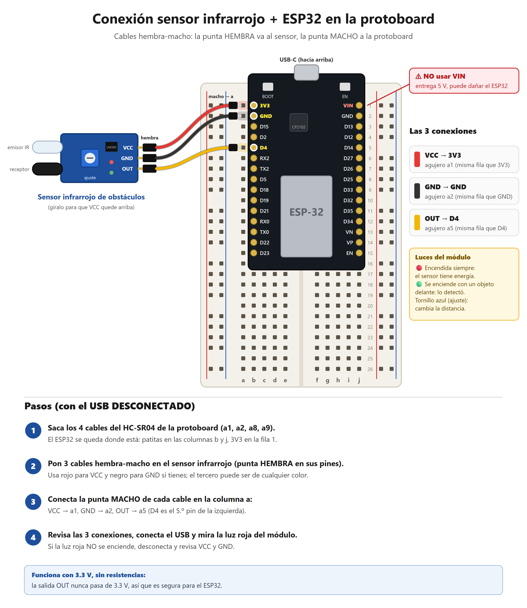
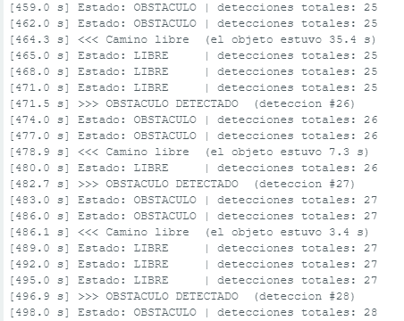
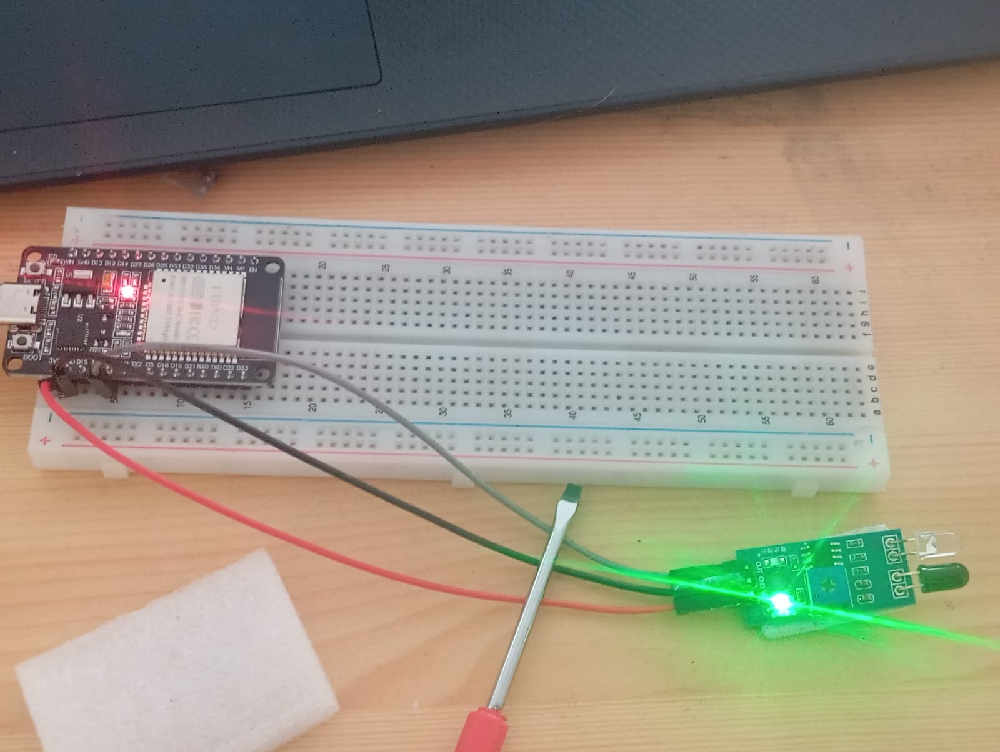
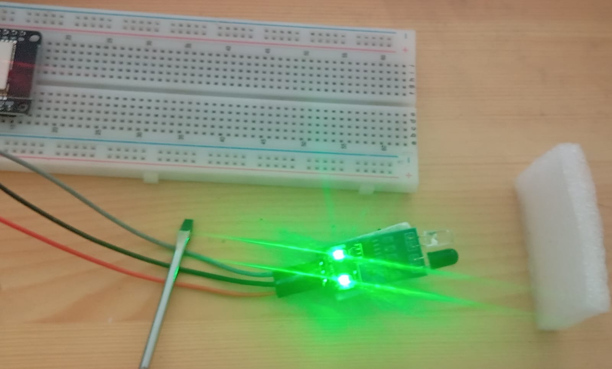

# Sensor infrarrojo de obstáculos con ESP32

Proyecto del curso de **Robótica**: un ESP32 lee un sensor infrarrojo de obstáculos y muestra cada detección en la consola serie (Monitor Serie del Arduino IDE).



## Materiales

- Placa ESP32 DevKit (USB-C, chip CP2102)
- Sensor infrarrojo de obstáculos (comparador LM393, salida digital)
- Protoboard y 3 cables jumper hembra-macho
- Cable USB-C y computadora con Arduino IDE 2.x y el paquete `esp32` de Espressif

## Conexiones

| Sensor | ESP32 |
| ------ | ----- |
| VCC    | 3V3   |
| GND    | GND   |
| OUT    | D4 (GPIO 4) |

El sensor se alimenta a 3.3 V para que su salida no supere el voltaje que admiten los pines del ESP32.



## Cómo usarlo

1. Abrir `sensor_infrarrojo/sensor_infrarrojo.ino` en el Arduino IDE.
2. **Tools → Board → esp32 → ESP32 Dev Module** y **Tools → Port →** el puerto COM de la placa.
3. Pulsar **Upload** (→).
4. Abrir el **Serial Monitor** a **115200 baud** y acercar la mano al sensor.

Si el sensor marca obstáculo todo el tiempo, alejarlo de la luz solar directa y girar el potenciómetro azul hasta que el LED de obstáculo se apague con el camino libre.

## Salida en consola

```text
[471.5 s] >>> OBSTACULO DETECTADO  (deteccion #26)
[474.0 s] Estado: OBSTACULO | detecciones totales: 26
[477.0 s] Estado: OBSTACULO | detecciones totales: 26
[478.9 s] <<< Camino libre  (el objeto estuvo 7.3 s)
[480.0 s] Estado: LIBRE     | detecciones totales: 26
```



## Contenido del repositorio

| Carpeta | Descripción |
| ------- | ----------- |
| `sensor_infrarrojo/` | Programa final: detección de obstáculos con eventos, contador y reporte cada 3 s |
| `sensor_ultrasonico/` | Primer intento con el HC-SR04, descartado: a 3.3 V no mide (necesita 5 V y un divisor de tensión en Echo) |
| `probador_protoboard/` | Utilidad para comprobar la continuidad de las filas de la protoboard usando el ESP32 |
| `docs/` | Diagrama de conexiones, fotos y captura de la consola |




